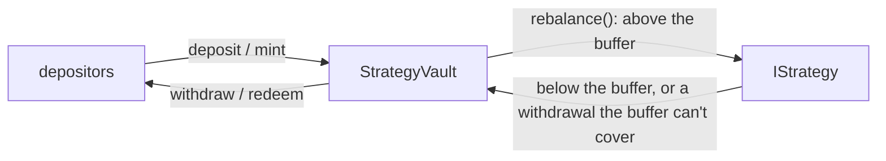

# erc4626-vault-kit

[](https://github.com/Urthella/erc4626-vault-kit/actions/workflows/ci.yml)

> **Unaudited.** For learning and testnets. Don't put real funds in it.

An [ERC-4626](https://eips.ethereum.org/EIPS/eip-4626) vault that keeps a buffer of idle assets for cheap withdrawals and puts the rest into a pluggable strategy, built on OpenZeppelin's audited `ERC4626` with Foundry tests around everything it adds.



## What it adds to ERC-4626

| | |
|---|---|
| **Pluggable strategy** | `IStrategy` has five functions. `totalAssets()` is idle balance plus the strategy's position, so yield and losses show up in the share price |
| **Idle buffer** | `rebalance()` keeps `bufferBps` of assets idle; withdrawals pull only the shortfall from the strategy |
| **Honest `max*`** | `maxWithdraw` / `maxRedeem` are capped by what the strategy can return right now, as the standard requires |
| **Deposit cap** | `depositCap` bounds total assets, reflected in `maxDeposit` / `maxMint` |
| **Safe migration** | `setStrategy` empties the old strategy and refuses if it can't, so no assets get stranded |
| **Slippage bounds** | ERC-5143 overloads like `deposit(assets, receiver, minShares)` |

## Security notes

**Inflation attack.** The classic first-depositor attack deposits 1 wei, donates a large amount so one share is worth a fortune, and lets the next deposit round down to nothing. The vault uses 10⁶ virtual shares (`_decimalsOffset() = 6`), so most of any donation belongs to those virtual shares. Under fuzzing ([InflationAttack.t.sol](test/InflationAttack.t.sol)) **the attacker always loses money and the victim loses at most a millionth of the donation**. Zeroing out a victim means burning a million times their deposit.

**Slippage protection.** Plain `deposit` stays ERC-4626 compliant, which means it can't refuse small deposits. Callers who want a hard guarantee pass a bound: if a front-run moves the price, `deposit(assets, receiver, minShares)` reverts and the caller keeps everything.

**Trust model.** The owner chooses the strategy and the strategy holds most of the assets, so a malicious strategy can steal them. Even so, the vault never trusts what a strategy *reports* sending back. It checks its own balance change and reverts with `StrategyIlliquid` on a shortfall.

## Use it

```bash
forge install Urthella/erc4626-vault-kit
```

```solidity
import {StrategyVault} from "erc4626-vault-kit/src/StrategyVault.sol";
import {IStrategy} from "erc4626-vault-kit/src/IStrategy.sol";

contract MyLendingStrategy is IStrategy { /* asset, totalAssets, available, deposit, withdraw */ }
```

## Tests

```bash
nix develop     # foundry
forge test
```

- **Unit tests** for buffering, pulling from the strategy, yield, caps, illiquidity, migration, slippage bounds and access control
- **Fuzzing**: a deposit followed by a redeem never returns more than went in, even after a direct donation to the vault
- **Inflation attack** fuzzed across donation and victim sizes

## License

[MIT](LICENSE)
